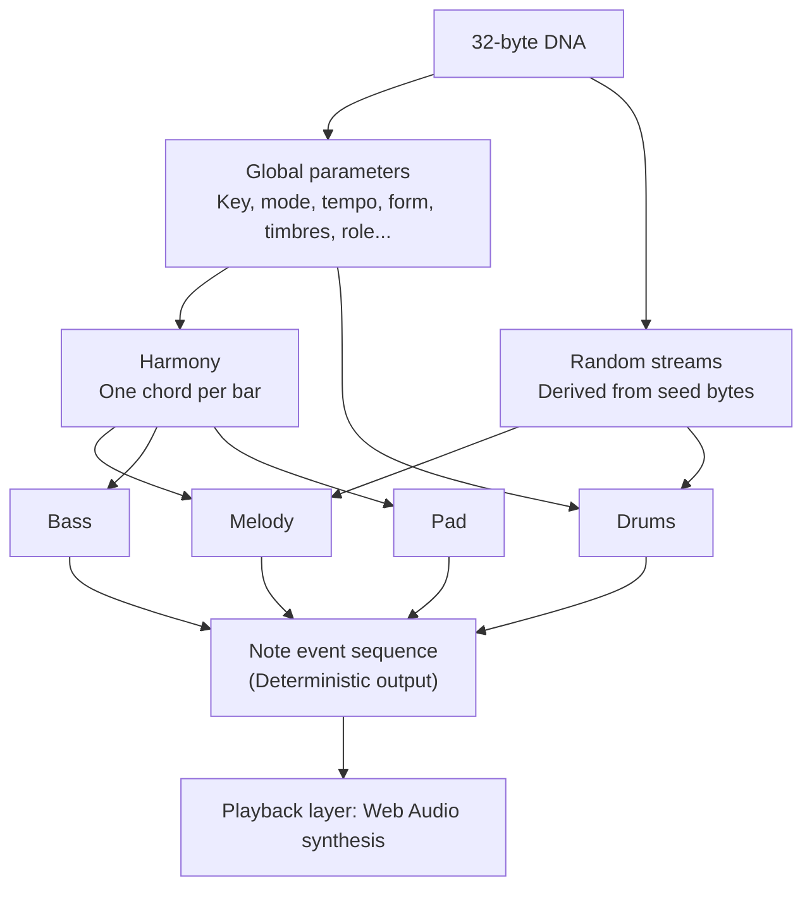

# Seedsong Music Generation Specification v2 (seedsong-music/2)

This document defines how the 32-byte DNA of a Seedsong record maps deterministically to a piece of music. Every implementation following this document must produce a byte-for-byte identical note event sequence for the same DNA. Cover artwork mapping (DNA bytes 10–15) and the DOB/0 and DOB/1 patterns are defined in [pattern.md](pattern.md) and are outside the scope of this document.

Version 2 preserves the v1 DNA layout, PRNG streams, rhythms, timbres, harmony,
and non-melody parts. It adds whole-melody pitch refinement after generating the
v1 draft. The same DNA can therefore produce different pitches in v1 and v2.
Always save the algorithm version together with DNA. The unchanged legacy rules
are archived in [spec-v1.md](spec-v1.md).

## 0. Conventions

- **Determinism boundary**: The decoder outputs a note event sequence (Section 11), which must be byte-for-byte identical. Rendering events into sound (Section 10) belongs to the playback layer and uses browser floating-point arithmetic; sample-for-sample consistency across platforms is not required.
- **Integers only**: Floating-point arithmetic is prohibited during decoding. All division is integer division truncated toward zero, and `%` denotes nonnegative modulo.
- **Byte numbering**: `D[i]` is DNA byte i, with indexing starting at 0.
- **Wallet consistency**: Parameters displayed as DOB/0 traits in wallets must strictly follow DOB/0 value selection semantics:
  - `options(list)` = `list[D[i] % list_length]`
  - `range(lo, hi)` = `lo + D[i] % (hi − lo)`, excluding hi

  These semantics have been checked against the official example: DNA `ac7b88` selects name index `0xac % 8 = 4` from 8 names, and age `range(0,100)` gives `0x7b % 100 = 23`. Weighted options are implemented by repeating entries in the list.
- **Time grid**: Fixed 4/4 time, with 16 sixteenth-note steps per bar. The complete piece has 16 bars, or 256 steps.

## 1. Generation overview

## 2. Byte mapping

| Byte(s) | Parameter | Calculation | Wallet trait |
| --- | --- | --- | --- |
| 0 | Mode | `options`, see 3.2 | Yes |
| 1 | Tempo (BPM) | `range(60, 141)`, or 60–140 | Yes |
| 2 | Chord progression template | `D[2] % 8`, see Section 4 | No |
| 3 | Melody contour | `options`, see 5.3 | Yes |
| 4 | Lead timbre | `options`, see 10.1 | Yes |
| 5 | Bass timbre | `options`, see 10.2 | Yes |
| 6–9 | Melody seed | Random stream `sng/melody` | No |
| 10–15 | Cover artwork | See [pattern.md](pattern.md) | Yes |
| 16 | Ensemble role | `options[melody, bass, harmony, rhythm]` | Yes |
| 17 | Key | `options[C, C#, D, D#, E, F, F#, G, G#, A, A#, B]` | Yes |
| 18 | Arrangement | Form = `D[18] % 4` (wallet trait Form); bass pattern = `(D[18] / 4) % 4`; pad pattern = `(D[18] / 16) % 4`; drum pattern = `(D[18] / 64) % 4` | Form only |
| 19 | Groove | Swing = `D[19] % 4`; density offset = `(D[19] / 4) % 4` | No |
| 20–31 | Variation and noise seeds | Random streams `sng/rhythm`, `sng/vary`, `sng/human`, `sng/noise` | No |

Note: The key uses `% 12`. Since 256 is not divisible by 12, the four keys C through D# are slightly more likely (22/256 versus 21/256), which is acceptable.

## 3. Global parameters

### 3.1 Tonic and register

- Tonic pitch class: `pc = D[17] % 12` (C = 0 … B = 11).
- Melody tonic: `tonic_mel = 60 + pc` if pc ≤ 7, otherwise `48 + pc`. The range is MIDI 56–67.
- Melody range: `[tonic_mel − 5, tonic_mel + 16]`, approximately one and a half octaves.
- Melody center: `center = tonic_mel + 5`.
- Bass tonic: `tonic_bass = 36 + pc`, in MIDI 36–47.

### 3.2 Mode

`D[0] % 32` indexes the following table. Index ranges represent repeated entries.

| Index | Mode | Probability | Scale (semitones above tonic) | Parent scale for harmony | Chord family |
| --- | --- | --- | --- | --- | --- |
| 0–7 | Major (Ionian) | 25% | 0 2 4 5 7 9 11 | Same as scale | Major |
| 8–15 | Minor (Aeolian) | 25% | 0 2 3 5 7 8 10 | Same as scale | Minor |
| 16–19 | Dorian | 12.5% | 0 2 3 5 7 9 10 | Same as scale | Minor |
| 20–23 | Mixolydian | 12.5% | 0 2 4 5 7 9 10 | Same as scale | Major |
| 24–27 | Major Pentatonic | 12.5% | 0 2 4 7 9 | Ionian | Major |
| 28–30 | Minor Pentatonic | 9.4% | 0 3 5 7 10 | Aeolian | Minor |
| 31 | Lydian | 3.1% (rare) | 0 2 4 6 7 9 11 | Same as scale | Major |

- **Melody scale**: The Scale column above; pentatonic modes contain 5 notes.
- **Parent scale for harmony**: The seven-note scale used to construct chords. Pentatonic modes use the corresponding Ionian or Aeolian scale.

### 3.3 Tempo and swing

- `bpm = 60 + D[1] % 81`.
- Swing: `swing = [0, 0, 12, 25][D[19] % 4]`, expressed as a percentage; see 10.4.

### 3.4 Form

The piece consists of 4 phrases of 4 bars each. `D[18] % 4` selects:

| Value | Form | Wallet display |
| --- | --- | --- |
| 0 | A A B A | AABA |
| 1 | A B A B | ABAB |
| 2 | A A B B | AABB |
| 3 | A B A C | ABAC |

## 4. Harmony

### 4.1 Chord progression templates

Chords are represented as degrees of the parent scale for harmony (0 = tonic … 6 = seventh degree). Each bar has one chord, and each template spans 4 bars.

| ID | Major family | Degrees | Minor family | Degrees |
| --- | --- | --- | --- | --- |
| 0 | I–V–vi–IV | 0 4 5 3 | i–VI–III–VII | 0 5 2 6 |
| 1 | I–vi–IV–V | 0 5 3 4 | i–iv–VII–III | 0 3 6 2 |
| 2 | vi–IV–I–V | 5 3 0 4 | i–VII–VI–VII | 0 6 5 6 |
| 3 | I–IV–vi–V | 0 3 5 4 | i–iv–v–i | 0 3 4 0 |
| 4 | I–V–IV–V | 0 4 3 4 | VI–VII–i–i | 5 6 0 0 |
| 5 | I–iii–IV–V | 0 2 3 4 | i–III–VII–iv | 0 2 6 3 |
| 6 | IV–I–V–vi | 3 0 4 5 | i–VI–iv–v | 0 5 3 4 |
| 7 | I–IV–I–V | 0 3 0 4 | i–iv–i–v | 0 3 0 4 |

Roman numerals are provided for readability; the numeric degrees are authoritative. Chord quality (major or minor triads) follows naturally from the mode. For example, degree 3 in Dorian is a major triad.

### 4.2 Progression for each phrase

Let `t = D[2] % 8`:

- Phrase A: template `t`.
- Phrase B: template `(t + 3) % 8`.
- Phrase C: template `(t + 5) % 8`.
- Force the final bar of the complete piece to degree 0 (the tonic chord), creating a sense of closure and a natural transition when looping.

### 4.3 Constructing triads

In the seven-note parent scale `S`, the triad on degree d consists of pitch classes `S[d]`, `S[(d+2)%7]`, and `S[(d+4)%7]`.

**Diminished-triad replacement**: If the interval from root to fifth is 6 semitones (a diminished triad), reconstruct the chord on degree `(d + 5) % 7`, a third below. For example, replace Ionian vii° with V and Lydian #iv° with II.

## 5. Melody

### 5.1 Random numbers

- String hash: 64-bit FNV-1a, with offset basis `0xcbf29ce484222325` and prime `0x100000001b3`.
- Seed: `seed = splitmix64(fnv1a64(label_ASCII_bytes ‖ seed_bytes))`. If the result is 0, use `0x9E3779B97F4A7C15` instead.
- splitmix64: `z = x + 0x9E3779B97F4A7C15; z = (z ^ (z >> 30)) * 0xBF58476D1CE4E5B9; z = (z ^ (z >> 27)) * 0x94D049BB133111EB; return z ^ (z >> 31)`, using 64-bit wrapping arithmetic throughout.
- Generator: xorshift64*, `x ^= x >> 12; x ^= x << 25; x ^= x >> 27; return x * 0x2545F4914F6CDD1D`.
- `below(n) = ((next() >> 32) * n) >> 32`, returning a value in `[0, n)`.
- `weighted(w)`: Set `r = below(sum(w))`, accumulate weights in order, and return the first index whose cumulative weight exceeds r.
- `chance(a, b)`: `below(b) < a`.

| Random stream | Label | Seed bytes |
| --- | --- | --- |
| Melody pitch | `sng/melody` | D[6..10] |
| Rhythm selection | `sng/rhythm` | D[6..10] ‖ D[20..24] |
| Phrase variation | `sng/vary` | D[20..32] |
| Velocity adjustment | `sng/human` | D[24..32] |
| Drum noise | `sng/noise` | D[20..32] |

Each stream advances independently without affecting the others.

### 5.2 Rhythm

Each bar is represented by 16 characters: `x` for onset, `-` for continuation, and `.` for rest. A note lasts until the next `x` or `.`, with no ties across bar boundaries.

| Category | ID | Pattern |
| --- | --- | --- |
| Sparse S | S0 | `x---x---x-------` |
| | S1 | `x-------x---x---` |
| | S2 | `x---x-------x---` |
| | S3 | `x-----x-x-------` |
| Medium M | M0 | `x-x-x---x-x-x---` |
| | M1 | `x---x-x-x---x---` |
| | M2 | `x-x---x-x-x-x---` |
| | M3 | `x--x--x-x---x-x-` |
| Dense D | D0 | `x-x-x-x-x-x-x-x-` |
| | D1 | `x-xxx-x-x-xxx-x-` |
| | D2 | `x-x-xx-xx-x-x---` |
| | D3 | `xxx-x-x-xxx-x---` |
| Ending E | E0 | `x---------------` |
| | E1 | `x-------x-------` |
| | E2 | `x---x-----------` |

**Selection**: On the first occurrence of each phrase letter (A, B, C), draw three items in order from `sng/rhythm`: primary rhythm r0, secondary rhythm r1, and ending pattern e.

- First select a category using tempo and density offset:

  | Tempo | S | M | D |
  | --- | --- | --- | --- |
  | < 80 | 20 | 50 | 30 |
  | 80–109 | 30 | 50 | 20 |
  | ≥ 110 | 50 | 40 | 10 |

  Density offset is `[0, −1, +1, 0][(D[19]/4) % 4]`. At −1, merge D's weight into S; at +1, merge S's weight into D. Phrases B and C receive an additional +1 for contrast, without accumulating the increase more than once.
- After choosing a category, select its pattern with `below(4)`. Draw the category and pattern separately for r0 and r1. Select ending e from E0–E2 with `below(3)`.
- The phrase's 4-bar rhythm is `[r0, r1, r0, e]`. Repeated rhythm patterns are essential to making the result feel like a song.

### 5.3 Melody contour

`D[3] % 8` indexes `[Smooth, Smooth, Smooth, Balanced, Balanced, Balanced, Balanced, Leapy]`. The contour determines interval-magnitude weights, measured in degrees of the melody scale:

| Contour | 0 degrees | 1 degree | 2 degrees | 3 degrees | 4 degrees |
| --- | --- | --- | --- | --- | --- |
| Smooth | 15 | 60 | 20 | 5 | 0 |
| Balanced | 10 | 50 | 25 | 10 | 5 |
| Leapy | 8 | 40 | 25 | 15 | 12 |

### 5.4 Pitch representation

The melody scale has n notes (7 or 5). An integer degree s represents pitch as `pitch(s) = tonic_mel + 12 × floor(s / n) + scale[s mod n]`. Here floor and mod use their mathematical definitions for negative values. Degree s = 0 is the melody tonic.

### 5.5 Draft note-by-note generation rules

Generate phrases in form order, processing onsets sequentially. Let `prev` be the previous note's degree and `last_iv` the previous interval. Before the first note of the piece, `prev = 0`. During phrases B and C, raise the center: `center_eff = center + 3`.

1. **Strong beats** (steps 0 and 8): First draw a candidate degree as for a weak beat, then snap it to a chord tone. Among all in-range notes belonging to both the current chord and the melody scale, choose the pitch closest to the candidate. Break ties by proximity to `prev`, then by the lower pitch.
   - This candidate set is never empty. The pentatonic scale with an Ionian parent omits degrees 4 and 7, while the one with an Aeolian parent omits degrees 2 and 6. The only triads containing both missing notes are vii° and ii°, respectively; both are diminished triads and have already been replaced in 4.3.
2. **Weak beats**:
   - If `|last_iv| ≥ 3` (the preceding motion was a large leap), force a one-degree step in the opposite direction: `iv = −sign(last_iv)`, consuming no random numbers.
   - Otherwise, `mag = weighted(contour_weights)`. For direction: when the pitch is above `center_eff + 7`, move downward with `chance(3,4)`; below `center_eff − 2`, move upward with `chance(3,4)`; otherwise move upward with `chance(1,2)`. Set `iv = ±mag`.
   - If `iv = 0` and the preceding two notes already have the same pitch, replace it with a one-degree step toward `center_eff`.
3. **Range**: If the result is out of range, reverse the direction while retaining the interval magnitude. If still out of range, choose the closest in-range scale note.
4. **Phrase ending**: Always snap the last onset of a phrase to a chord tone using the strong-beat rule. Force the last onset of the entire piece to the tonic closest to `prev`, choosing from the in-range values of `tonic_mel` and `tonic_mel + 12`.

### 5.6 Draft repetition and variation

- On the first occurrence of a letter, generate all 4 bars with `sng/melody` according to the rules above.
- When that letter appears again, copy the first occurrence's first 3 bars note for note. Regenerate bar 4 using `sng/vary` and the same rules, starting with `prev` set to the last note of bar 3.
- If this is the final phrase of the piece, also regenerate bar 4 and apply the tonic ending from rule 4 of 5.5.

### 5.7 Velocity

Base velocity depends on the step: step 0 = 100; step 8 = 92; steps 4 and 12 = 84; other even steps = 76; odd steps = 68. Add `below(9) − 4` from `sng/human` to every note, then clamp to 1–127.

### 5.8 Whole-melody pitch refinement (v2)

After Sections 5.1–5.7 generate the complete v1 melody draft, refine all melody
pitches in one integer-only dynamic-programming pass. This pass consumes no
random values. Start steps, durations, velocities, the 16-bar form, all rhythms,
and the complete bass, pad and drum parts remain unchanged. Draft motifs remain
the pitch targets; repeated phrases can receive different pitch adjustments at
transitions, so exact pitch copying applies to the draft rather than the final
v2 output.

For `N` melody notes, let `budget = floor((N - 1) * 8 / 100)`. Candidate pitches
are the in-range scale degrees returned by Section 3.1. Strong-beat notes
(steps 0 and 8) and the last note in a phrase-ending bar must be chord tones.
The final melody note must be either `tonic_mel` or `tonic_mel + 12`.

Reject paths containing three identical consecutive pitches or more than
`budget` adjacent intervals of at least four scale degrees. This includes
phrase boundaries. The note-by-note draft rules are preferences for pitch
shape; the final output must satisfy these whole-sequence constraints.

Minimize the sum of the following integer costs:

- For every note: `16 * abs(candidate_pitch - draft_pitch)` in semitones.
- For every transition: `2 * interval * interval`, where `interval` is the signed
  scale-degree difference.
- Add 64 when `abs(interval) >= 4`.
- Add 6 when the candidate repeats the previous pitch.
- Add 8 when both the actual and draft intervals are nonzero and have opposite
  signs. The draft interval compares the original draft pitches, not partially
  refined output.

The DP state is `(large_leaps_used, degree_index, run)`, where degrees are sorted
ascending and `run` is 1 or 2. Its flat index is
`(large_leaps_used * degree_count + degree_index) * 2 + (run - 1)`.
Initialize every allowed first-note candidate with its deviation cost, zero
leaps, and run 1. For each following note, enumerate candidate degree indices
ascending, then predecessor state indices ascending. Update a state only for
strictly lower cost, retaining the first predecessor on ties. Choose the final
state by `(cost, state_index)` and backtrack. These tie rules are normative.
All path costs use unsigned 32-bit integers; unreachable states have cost
`u32::MAX / 4`. Valid v2 DNA must have a feasible path; implementations must not
silently relax constraints or fall back to a failing draft.

## 6. Bass

- Pitch: For current chord root pitch class r, `root = 36 + r`. The fifth is `fifth = root + 7`; subtract 12 if it exceeds 47.
- Select the pattern with `(D[18] / 4) % 4`:

| ID | Pattern | Notes |
| --- | --- | --- |
| B0 | `x---------------` | Root |
| B1 | `x-------x-------` | Root, root |
| B2 | `x-------x-------` | Root, fifth |
| B3 | `x---x---x---x---` | Root, root one octave higher, root, root one octave higher |

- Velocity: 96 at step 0, otherwise 84. The final bar of the piece always uses B0.

## 7. Pad

- **Voicing**: Use root position for the first chord, placing its lowest note in `[52, 64)`. For each subsequent chord, choose among the three inversions, each with its lowest note in `[52, 64)`, to minimize the total semitone movement of the three voices, paired in sorted order. Break ties in this order: root position, first inversion, second inversion.
- Select the pattern with `(D[18] / 16) % 4`:

| ID | Name | Rule |
| --- | --- | --- |
| P0 | Sustained | All three notes at step 0, lasting 16 steps |
| P1 | Half notes | All three notes at steps 0 and 8, each lasting 8 steps |
| P2 | Arpeggio | One note at each of steps 0, 2, 4 … 14, cycling low, middle, high, middle; each lasts 2 steps |
| P3 | Offbeat | All three notes at steps 4 and 12, each lasting 2 steps |

- Fixed velocity: 64.

## 8. Drums

Select the pattern with `(D[18] / 64) % 4`. Note numbers follow General MIDI: 36 = kick, 38 = snare, 42 = closed hi-hat.

| ID | Name | Kick | Snare | Hi-hat |
| --- | --- | --- | --- | --- |
| K0 | Basic | `x-------x-------` | `----x-------x---` | `x-x-x-x-x-x-x-x-` |
| K1 | Half-time | `x---------x-----` | `--------x-------` | `x---x---x---x---` |
| K2 | Four-on-the-floor | `x---x---x---x---` | `----x-------x---` | `--x---x---x---x-` |
| K3 | Ambient | `x---------------` | (none) | `--------x-------` |

- Fills: For K0 and K2, add a snare at each of steps 14 and 15 in the last bar of every phrase, except the final bar of the whole piece.
- Drum notes last 1 step. Velocities: kick = 100, snare = 90, hi-hat = `60 + below(16)` from `sng/human`.

## 9. Ensembles

### 9.1 Solo playback

When a record plays alone, its DNA generates all four parts. Its ensemble role (D[16]) receives a 3 dB mixing boost to make it the featured part.

### 9.2 Ensemble mode

- **Input**: One conductor record and at most one participant record for each part. The conductor performs its own part.
- **Ensemble context** comes from the conductor: key, mode, tempo, swing, form, and chord progression, including the tonic chord in the final bar.
- Each participant generates events only for its own part:
  - Harmony, form, and tempo always use the ensemble context.
  - Melody contour, rhythm, pitch random stream, bass pattern, pad pattern, drum pattern, timbres, and all other parameters come from that participant's own DNA.
- Merge the parts' events and sort them as specified in Section 11. The ensemble result is therefore fully determined by the conductor DNA plus each part's DNA, and is identical on every playback.

## 10. Playback layer (non-normative)

This section describes the reference implementation's timbres. They may be adjusted without changing the specification version, but reference implementations should follow them for a consistent experience.

### 10.1 Lead timbre (D[4] % 32)

| Index | Name | Synthesis | ADSR envelope (ms; S in ‰) | Probability |
| --- | --- | --- | --- | --- |
| 0–9 | Soft Sine | Additive: harmonic amplitudes in ‰ [1000, 250, 80] | 10 / 300 / 600 / 200 | 31.3% |
| 10–16 | Warm Organ | Additive: [1000, 500, 330, 250, 200, 160] | 15 / 50 / 900 / 120 | 21.9% |
| 17–22 | E-Piano | FM: frequency ratio 1:1; modulation index decays from 2.0 to 0.3 over 800 ms | 5 / 900 / 300 / 300 | 18.8% |
| 23–27 | Glass Bell | FM: frequency ratio 7:2; index decays from 3.0 to 0 over 1500 ms | 2 / 1800 / 0 / 600 | 15.6% |
| 28–30 | Music Box | FM: frequency ratio 4:1; index decays from 1.5 to 0 over 400 ms | 2 / 700 / 0 / 300 | 9.4% |
| 31 | Crystal (rare) | Inharmonic additive: frequency ratios in ‰ [1000, 2756, 5404, 8933], amplitudes in ‰ [1000, 500, 250, 120] | 2 / 2500 / 0 / 800 | 3.1% |

### 10.2 Bass timbre (D[5] % 4)

| Index | Name | Synthesis | Envelope |
| --- | --- | --- | --- |
| 0–1 | Sine Sub | Additive: [1000, 150] | 5 / 100 / 900 / 100 |
| 2 | Round FM | FM: 1:1, constant index 1.0 | 5 / 200 / 700 / 100 |
| 3 | Pluck Bass | FM: 1:2; index decays from 2.5 to 0.2 over 300 ms | 2 / 400 / 200 / 100 |

### 10.3 Pad and drums

- Pad: Additive [1000, 400, 200], envelope 400 / 0 / 1000 / 800.
- Kick: Sine wave with frequency falling exponentially from 150 Hz to 50 Hz over 120 ms.
- Snare: Noise through an 1800 Hz band-pass filter, decaying over 150 ms, plus a 180 Hz sine wave.
- Hi-hat: Noise through a 7000 Hz high-pass filter, decaying over 50 ms.
- Noise buffer: Generate 44,100 samples from `sng/noise`, taking `next() >> 48` for each sample and interpreting it as a signed 16-bit integer.

### 10.4 Timing and volume

- Frequency: Twelve-tone equal temperament, A4 (MIDI 69) = 440 Hz.
- Step duration: `60 / bpm / 4` seconds. Swing delays steps 2, 6, 10, and 14 (offbeat eighth notes) by `swing% × step_duration`.
- Mixing gains: melody = 1.0, bass = 0.8, pad = 0.45, drums = 0.7. After summing all parts, normalize by peak amplitude to prevent clipping.
- Loop playback must join the end and beginning seamlessly.

## 11. Output format (normative)

The decoder outputs a binary block. All multibyte integers are little-endian.

**Header (16 bytes)**

| Offset | Type | Field |
| --- | --- | --- |
| 0 | 4 bytes | Magic `SNG1` |
| 4 | u8 | Music algorithm version, fixed at 2 |
| 5 | u8 | bpm |
| 6 | u8 | Tonic pitch class pc |
| 7 | u8 | Mode index (0–6, in the row order of the table in 3.2) |
| 8 | u8 | Form (0–3) |
| 9 | u8 | Lead timbre index (0–5) |
| 10 | u8 | Bass timbre index (0–2) |
| 11 | u8 | Pad pattern (0–3) |
| 12 | u8 | Bass pattern (0–3) |
| 13 | u8 | Drum pattern (0–3) |
| 14 | u8 | Swing percentage |
| 15 | u8 | Ensemble role (0 melody, 1 bass, 2 harmony, 3 rhythm) |

**Event section**: A `u16` event count, followed by 8 bytes per event:

| Offset | Type | Field |
| --- | --- | --- |
| 0 | u16 | Start step (0–255) |
| 2 | u16 | Duration (steps) |
| 4 | u8 | Part (same numbering as header byte 15) |
| 5 | u8 | MIDI pitch |
| 6 | u8 | Velocity |
| 7 | u8 | Reserved, set to 0 |

Sort events in ascending order by (start step, part, pitch). In ensemble mode, header fields come from the conductor record.

## 12. Quality checks

During M1, run the following checks on 1,000 reproducibly generated pseudorandom DNA values and write the results to a report. All metrics apply to final v2 pitches, including transitions across phrase boundaries:

| Metric | Expected |
| --- | --- |
| Non-chord tones on strong beats | 0 (guaranteed by the rules; used to verify the implementation) |
| Melody notes outside the range | 0 |
| Proportion of adjacent intervals ≥ 4 scale degrees | ≤ 8% in every piece (and therefore in aggregate) |
| Runs of 3 or more identical consecutive pitches | 0 |
| Final melody note is the tonic | 100% |
| Melody note count | 40–160 per piece |

## 13. Test vectors and example

The repository provides `vectors/music-v2.json`, containing at least 100 DNA values and their output in hexadecimal, as the acceptance baseline for all implementations.

**Parameter decoding example**: The first 20 DNA bytes are `9a 40 1c 07 e8 55 3f a2 71 0c … 02 09 b6 2d`. Omitted bytes do not affect these parameters.

| Byte | Value | Calculation | Result |
| --- | --- | --- | --- |
| 0 | 0x9a = 154 | 154 % 32 = 26 | Major Pentatonic |
| 1 | 0x40 = 64 | 60 + 64 % 81 | 124 BPM |
| 2 | 0x1c = 28 | 28 % 8 = 4 | Major-family template 4: I–V–IV–V |
| 3 | 0x07 = 7 | 7 % 8 = 7 | Leapy |
| 4 | 0xe8 = 232 | 232 % 32 = 8 | Soft Sine |
| 5 | 0x55 = 85 | 85 % 4 = 1 | Sine Sub |
| 16 | 0x02 | 2 % 4 | Harmony |
| 17 | 0x09 | 9 % 12 | A |
| 18 | 0xb6 = 182 | 182 % 4 = 2; 45 % 4 = 1; 11 % 4 = 3; 2 % 4 = 2 | Form AABB; bass B1; pad P3; drums K2 |
| 19 | 0x2d = 45 | 45 % 4 = 1; 11 % 4 = 3 | Swing 0%; density offset 0 |

The result is A major pentatonic at 124 BPM, with `tonic_mel = 48 + 9 = 57` (A3) and a melody range of MIDI 52–73. Phrase A uses chords A–E–D–E. Phrase B uses template (4+3)%8 = 7, giving A–D–A–E. The final bar of the piece is changed to A.

## 14. Remix inheritance (for reference by remix mechanics)

Derivation of child DNA is described in proposal 6.1. This specification defines field groups, each inherited as a whole from parent A or B:

| Group | Bytes | Type |
| --- | --- | --- |
| Mode | 0 | Structural |
| Tempo | 1 | Structural |
| Chord progression | 2 | Structural |
| Contour | 3 | Structural |
| Lead timbre | 4 | Structural |
| Bass timbre | 5 | Structural |
| Cover artwork | 10–15 | Structural (six independent byte groups; see [pattern.md](pattern.md)) |
| Role | 16 | Structural |
| Key | 17 | Structural |
| Arrangement | 18 | Structural |
| Groove | 19 | Structural |
| Seeds | 6–9, 20–31 | Seed (derived from the remix seed, not inherited) |

## 15. Versioning rules

This document defines `seedsong-music/2`; the SNG1 container magic stays unchanged and header byte 4 is 2. Any subsequent change affecting Section 11 must increment the music version again and use a new decoder Cell. Legacy v1 output remains available through `MusicVersion::V1`, CLI `--music-version 1`, and JS `musicVersion: 1`. Previously minted records always use the decoder referenced by their Cluster and are not changed by upgrades.
